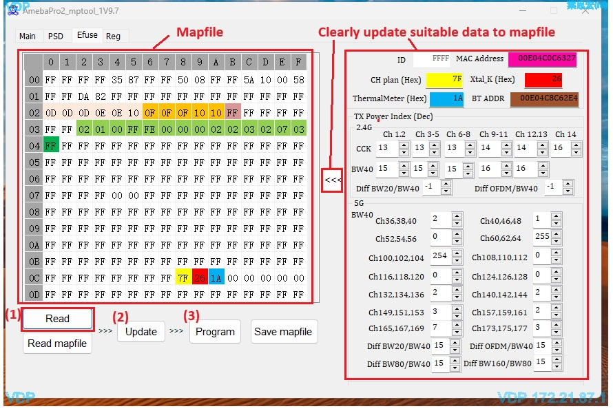

Efuse Introduction
==================

.. contents::
  :local:
  :depth: 2

MP Tool – Efuse Page Overview
-----------------------------

The ``Efuse`` page of the MP Tool is used to read the efuse content of the AmebaPro2 IC and to program calibration data (such as ``CH plan``, ``Xtal_K``, ``ThermalMeter`` and ``TX Power Index``) into the efuse.

- **Mapfile** (left side): shows the efuse map read from the IC in hexadecimal format.
- **Data fields** (right side): shows the decoded data of the mapfile, e.g. ``ID``, ``MAC Address``, ``CH plan (Hex)``, ``Xtal_K (Hex)``, ``ThermalMeter (Hex)``, ``BT ADDR`` and ``TX Power Index (Dec)`` for 2.4G and 5G. Make sure the suitable data is updated to the mapfile clearly.

Steps 1 to 3 correspond to the red labels in the figure below.

   MP Tool Efuse page

1. **Read mapfile from IC Efuse**

   Click ``Read`` to read the current efuse content from the IC. The result is shown in the ``Mapfile`` area, and the decoded values are shown in the data fields on the right side.

2. **Update**

   After modifying the data fields on the right side, click ``Update`` to apply the values to the mapfile.

3. **Program (PG)**

   Click ``Program`` to write the mapfile into the AmebaPro2 efuse.

.. warning::

   Steps 2 and 3 operate on the AmebaPro2 efuse based on the mapfile. Efuse is one-time programmable, and bits that have been programmed cannot be restored. Please use these operations carefully, and double-check the mapfile content before clicking ``Program``.
