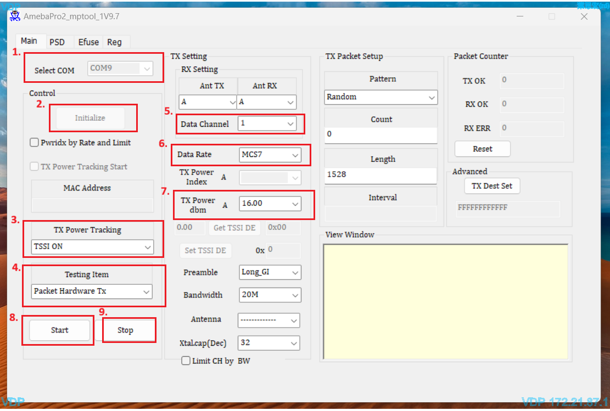

How to Use WiFi MP Tool
=======================

.. contents::
  :local:
  :depth: 2

MP Tool – Packet Hardware TX Test Procedure
-------------------------------------------

Please follow the steps below to configure the MP Tool for Packet Hardware TX testing. Steps 1 to 9 correspond to the red labels in the figure below.

   MP Tool Packet Hardware TX setting

1. **Select COM Port**

   Select the COM port corresponding to the DUT in the ``Select COM`` drop-down list.

2. **Initialize the DUT**

   Click ``Initialize`` to establish communication with the DUT and enter MP test mode.

3. **Enable TX Power Tracking**

   Set ``TX Power Tracking`` to ``TSSI ON``.

4. **Select Testing Item**

   Select ``Packet Hardware Tx`` as the ``Testing Item``.

5. **Set Data Channel**

   Select the required Wi-Fi channel in ``Data Channel``.

   Example: Channel ``1`` for 2.4 GHz testing.

6. **Set Data Rate**

   Select the required transmission data rate in ``Data Rate``.

   Example: ``MCS7``.

7. **Set TX Power**

   Configure the target TX power level in ``TX Power dbm``.

   Example: ``16.00`` dBm.

8. **Start TX Test**

   Click ``Start`` to begin continuous packet transmission with the configured parameters.

9. **Stop TX Test**

   To stop the test, click ``Stop`` to end the packet transmission.

.. note::

   If any unexpected issue occurs during the test, close and restart the MP Tool, then repeat the procedure from step 1.
